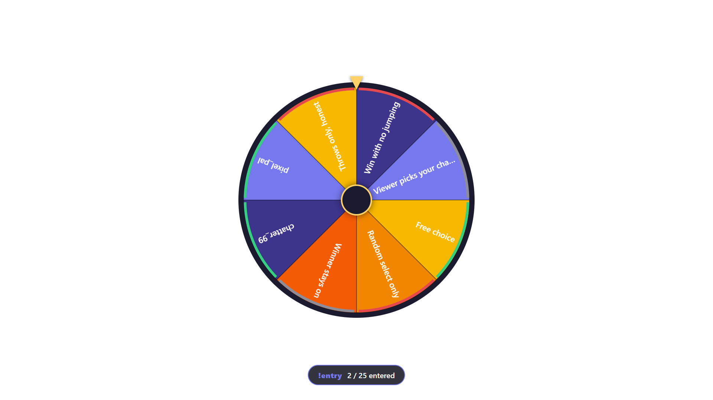
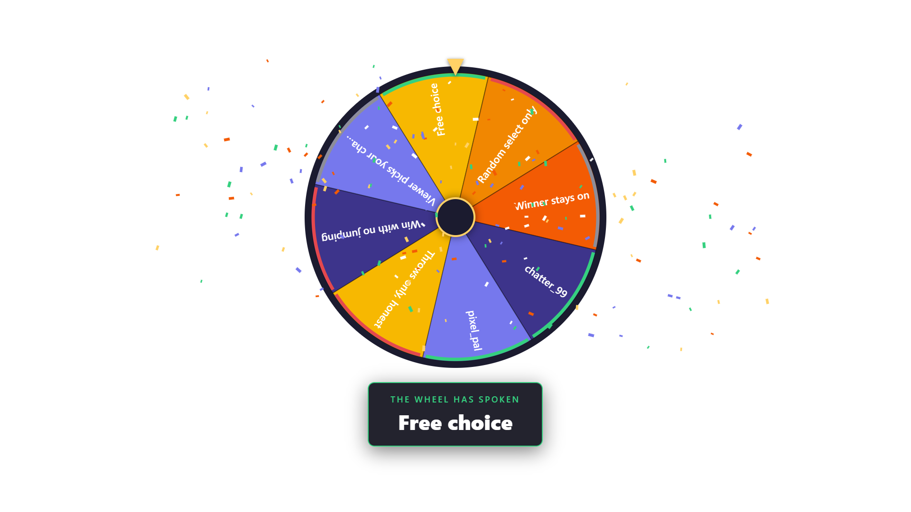

# Fortuna — a Wheel of Fate overlay, driven by Streamer.bot

Fortuna is a randomizer-wheel browser-source overlay (OBS, Streamlabs, or any
Chromium ≥ 80 streaming app): load it with names, objectives, or
stipulations, hit **SPIN**, and the wheel decelerates onto a result. Entries
carry a *good / bad / neutral* tag — a good draw pops confetti, a bad draw
pours rain, neutral gets a subtle glow (all re-skinnable). Viewers can enter
drawings from chat with `!entry` or spin the wheel with Twitch channel points.
Theme designers can restyle the wheel with
CSS variables or replace the whole presentation (Magic 8-ball, crystal ball…)
— see [docs/THEMING.md](docs/THEMING.md).




- **No cloud, no accounts** — everything runs on your machine over
  Streamer.bot's WebSocket.
- **Deterministic spins** — the sidecar picks the winner once; every OBS
  source and the control page derive the identical animation and land on the
  same slice at the same moment ([docs/PROTOCOL.md](docs/PROTOCOL.md)).
- **State survives restarts** — entries, settings, and the last draw persist
  in `config.json`; overlays repaint on reconnect via a sync-on-connect replay.

## Pieces

| Piece | What it is |
|---|---|
| `overlay/wheel.html` | The OBS browser source (canvas wheel + effects) |
| `fortuna-shared/control.html` | Streamer control page (browser tab or OBS custom dock) |
| `fortuna-sidecar.mjs` | The one Node process — owns entries, timers, and the spin decision |
| `actions/*.cs` | Two tiny Streamer.bot C# actions (+ optional auto-start launcher) |
| `mock-sb-server.mjs` | A fake Streamer.bot for styling/dev with no SB install (`npm start`) |

## Setup

Requirements: [Streamer.bot](https://streamer.bot) 1.0.4+, Node ≥ 18, OBS.

First, get the code onto the machine that runs Streamer.bot — either

```
git clone https://github.com/FlashGalatine/fortuna-wheel.git
```

or click **<> Code → Download ZIP** on the repo page and extract it. The
`<repo>` paths below refer to that folder.

### 1. Streamer.bot servers

- **WebSocket Server** (Servers/Clients → WebSocket Server): Start it on
  `127.0.0.1:8080` with **Authentication OFF**.
- **HTTP Server** (Servers/Clients → HTTP Server): Start it on `7474` and add
  two Path → Folder maps pointing into this repo:

| Path | Folder |
|---|---|
| `fortuna-overlay` | `<repo>\overlay` |
| `fortuna-shared` | `<repo>\fortuna-shared` |

### 2. The two actions

Create two actions, each with a single **Core → C# → Execute C# Code**
sub-action, named **exactly**:

- `Fortuna Push` — paste [actions/fortuna-push.cs](actions/fortuna-push.cs), then click *Save and Compile*.
- `Fortuna Command` — paste [actions/fortuna-command.cs](actions/fortuna-command.cs), then click *Save and Compile*.

Optional: `Fortuna Sidecar Start`
([actions/fortuna-sidecar-start.cs](actions/fortuna-sidecar-start.cs), needs a
System.dll reference — instructions in the file header) so SB launches the
sidecar automatically.

### 3. Chat and channel point triggers (optional)

Add these triggers straight onto the `Fortuna Command` action — no Set Argument
sub-actions needed (the action detects them itself):

- **Command** `!entry` — viewers join an open drawing; `user`/`userId` are
  relayed automatically (one entry per viewer).
- **Command** `!wheel <cmd> [value…]` — mod controls: `!wheel openEntries`,
  `!wheel closeEntries`, `!wheel addEntry Run it back | bad`, `!wheel spin`.
  Restrict this trigger to moderators in SB: by default, anyone in chat can run a
  command, and this one can wipe the wheel.
- **Twitch → Channel Reward → Reward Redemption** — pick your reward; every
  redeem spins the wheel. Anything the viewer types is ignored. Use this trigger,
  not *Reward Redemption Updated*, which fires when you approve or reject a redeem.
  Attached here, Fortuna ignores it; a separate action that sets its own `command`
  still runs on every approve and reject. Test with a real redeem, because
  Streamer.bot's Test Trigger may not set the arguments Fortuna looks for. On
  Streamer.bot 1.0.7, Test Trigger on *Reward Redemption Updated* with no reward
  picked crashed Streamer.bot itself, so avoid it.

Kick rewards aren't detected yet, so attached here they do nothing. Use a separate
action, as described below.

**Updating an existing install:**

1. Get the new files (`git pull`, or extract the new ZIP over your folder).
2. Stop the sidecar by closing its window. If `Fortuna Sidecar Start` launched it,
   end its `node.exe` in Task Manager: it has no window, and a new copy exits
   without replacing a running one.
3. Paste the current `fortuna-command.cs` into the action and click *Save and Compile*.
   *Compile* alone only tests the code and doesn't save it.
4. If you added a *Set Argument* for `command` or `value` inside `Fortuna Command`,
   delete it and use a separate action, as described below. Updating doesn't remove it.
5. Start the sidecar again, and reload the control page and any OBS docks.

**Set a cooldown of at least 10 seconds on a spin reward** (in its Twitch
settings). A spin takes up to about 8 seconds, and a redeem is refused while the
wheel is spinning or empty, but the viewer still loses the points. A redeem also
closes an open viewer drawing, because nobody can join mid-spin.

**A reward that should do something else, or a Stream Deck button,** gets its own
action: *Set Argument* `command` (and `value` if needed), then *Run Action*
`Fortuna Command`. For example, `command` = `entry` lets viewers buy their way
into an open drawing. A redeem while entries are closed does nothing, and still
costs the points.

> **Never add a *Set Argument* for `command` or `value` inside `Fortuna Command`
> itself.** A fixed `command` rewrites every trigger and Stream Deck call that
> reaches the action: with `spin`, any viewer's `!entry` spins the wheel. A fixed
> `value` replaces every Stream Deck call's value. If the sidecar or action is out of
> date, it also rewrites Fortuna's own status messages, and the wheel spins on its
> own and never stops. An out-of-date control page spins it at every status check
> until you reload it.

### 4. Run the sidecar

Double-click `start-fortuna.bat` (installs deps on first run), or
`npm install && npm run sidecar`. A single-instance guard on :7493 makes double
launches harmless.

### 5. OBS sources

- **Wheel overlay**: Browser source → `http://127.0.0.1:7474/fortuna-overlay/wheel.html`
  (1920×1080 recommended).
- **Control page**: open `http://127.0.0.1:7474/fortuna-shared/control.html` in
  a browser, or dock it: OBS → Docks → Custom Browser Docks.

## Using it

1. Add entries on the control page (or `setEntries` your own list) and tag them.
2. **SPIN.** The result card pops with the tag's effect. “Remove it from the
   wheel” appears under the last draw; or tick *remove the drawn entry
   afterwards* / the always-on setting for elimination-style wheels.
3. **Viewer drawings**: set max entries and/or a time window, click *Open
   entries*, and chat joins with `!entry`. When it fills up or times out the
   Spin button pulses — the spin itself stays in your hands.

## Dev / verification

- `npm start` — mock Streamer.bot (HTTP :7474 + WS :8080) with a landing page;
  `/mock/fixture` broadcasts a sample wheel, POST `/mock/push` any payload.
- `npm run verify` — 167 offline checks: spin math determinism, the real
  panel-core against the mock (subscribe case, sync replay, serialized queue),
  HTTP maps, the mock's copy of the action's mapping, a real sidecar E2E (entry CRUD,
  `!entry` dedupe/limits, spin lifecycle, channel point redeems, hostile chat JSON,
  restart persistence), and the real `fortuna-command.cs` against a stub `CPH`. Those last 43
  need the .NET Framework's `csc.exe` and are reported as skipped without it; they
  prove the action's logic, not real Streamer.bot behavior. Uses off-default ports
  (7478/8084/7494) so it runs beside a live SB.
- `npm run verify:render` — real-pixel checks in a system Edge/Chrome
  (`npm i --no-save playwright-core` first): painted wheel, revealed draw with
  confetti on the fx layer, control page. Writes gitignored PNGs.
- `npm run shots` — regenerates the docs screenshots.

## Ports

| Port | What |
|---|---|
| 8080 / 7474 | Streamer.bot WebSocket / HTTP (or the mock's mimics) |
| 7493 | Sidecar single-instance guard (`FORTUNA_GUARD_PORT`) |
| 7478 / 8084 / 7494 | verify-suite off-default ports |

## Author & support

Built by **Ashe "Flash" Galatine**.

- Email — [AsheJunius@gmail.com](mailto:AsheJunius@gmail.com)
- X — [@AsheJunius](https://x.com/AsheJunius) · BlueSky — [@projectgalatine.com](https://bsky.app/profile/projectgalatine.com)
- Twitch — [FlashGalatine](https://www.twitch.tv/FlashGalatine)
- Support — Patreon [ProjectGalatine](https://www.patreon.com/ProjectGalatine) · CashApp [$ProjectGalatine](https://cash.app/$ProjectGalatine)

## Credits & license

MIT — see [LICENSE](LICENSE). Sole runtime dependency is
[ws](https://github.com/websockets/ws) (MIT). See
[THIRD_PARTY_NOTICES.md](THIRD_PARTY_NOTICES.md).
